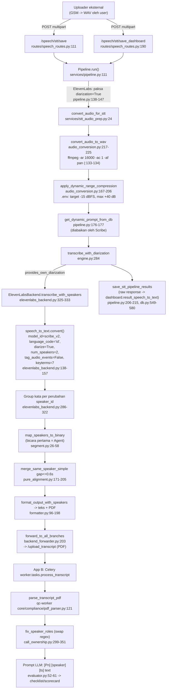

# Audit Diarization — STT Telemarketing (App A) + Konsumen QC (App B)

- Branch: `feat/diarization-scribe-audit` (dari `main` @ `114c2c1`)
- Tanggal: 2026-10-28
- Cakupan: read-only. Tidak ada perubahan kode, tidak ada panggilan API, tidak ada migration.
- Repo yang dibaca:
  - App A (repo ini): `/data/speech_to_text_v4/refactored`
  - App B (read-only): `/data/scorecard_v2/telemarketing-qc-worker`, `/data/scorecard_v2/telemarketing-qc-api`
- SDK yang diverifikasi: `elevenlabs==2.56.0` di `/data/speech_to_text/.venv`. Ini venv yang dipakai proses gunicorn `server:app` di port 8000/8001.
- Format audio: GSM asli, dikonversi ke WAV oleh user sebelum di-upload (konfirmasi user, 2026-10-28).

---

## 1. Ringkasan eksekutif

Revisi 2 menambahkan data produksi **campaign Cashline**: 1.417 rekaman unik (861 Not Qualified, 558 Qualified). Detailnya ada di §5.

1. Di produksi (repo `refactored`, dikonfirmasi user), Scribe v2 adalah satu-satunya sumber diarization. Pyannote dan NeMo **tidak dipanggil** (`engine.py:178-188`).
2. **Role tertukar adalah masalah terbesar dan sudah terukur.** Aturan "bicara pertama = Agent" (`segment.py:46-47`) bertentangan dengan cue skrip agent pada **14,3% call NQ dan 15,8% call PASS**. Angka ini cocok dengan pengukuran App B (31/217 = 14,3%). Sebaliknya, aturan "speaker dengan kata terbanyak = Agent" sejalan dengan cue skrip pada ~96% call.
3. **Speaker tergabung bukan disebabkan cluster yang hilang.** 98,7% call memang menghasilkan tepat 2 speaker, sehingga S1/F3 turun menjadi severity rendah. Masalahnya ada pada **potongan ucapan yang salah atribusi**: frasa skrip agent muncul di bawah 2 label berbeda pada 15% call, dan 10% call hanya punya ≤31 kata untuk speaker minoritas. Kandidat penyebab: threshold default yang terkunci karena `num_speakers=2`, dan DRC agresif.
4. **Flip 1 kata tanpa jeda jarang terjadi** (median 0,03 per 100 kata). Keluhan "label pindah di tengah kalimat" lebih mungkin berasal dari salah atribusi per potongan (poin 3) dan dari role yang tertukar.
5. **Error diarization tidak lebih banyak pada tiket NQ dibanding PASS** (semua metrik setara). Jadi NQ bukan "akibat diarization" secara massal. Dampaknya per item checklist masih perlu diukur dengan ground truth.
6. Belum ada abstraksi `DiarizationProvider` dan belum ada cache, tetapi raw response sudah tersimpan di DB (34.533 baris) sehingga bisa dipakai sebagai cache. Repo App A **tidak punya test**.
7. Kepatuhan: ElevenLabs **sudah disetujui legal/compliance** (konfirmasi user). `enable_logging` belum di-set. Tidak ada transkrip yang ikut ter-log di App A.

---

## 2. Peta alur saat ini

### 2.1 Parameter Scribe yang dikirim saat ini

Sumbernya `elevenlabs_backend.py:138-149`, `config.py:281-294`, dan `.env`.

| Parameter | Nilai sekarang | Catatan dari SDK 2.56.0 (`speech_to_text/client.py`) |
|---|---|---|
| `model_id` | `scribe_v2` | — |
| `diarize` | `True` (dipaksa untuk backend ElevenLabs, `pipeline.py:138-147`) | — |
| `num_speakers` | `2` (`.env:103`) | **"The maximum amount of speakers"** (client.py:54). Ini batas atas, bukan jumlah pasti. |
| `diarization_threshold` | tidak dikirim | **"Can only be set when diarize=True and num_speakers=None"**, default ~0.22 (client.py:63). Artinya sekarang tidak bisa di-tuning. |
| `language_code` | `"id"` (default Form di `speech_routes.py:116,195`) | Menerima ISO-639-1 maupun -3, jadi bahasa **tidak** auto-detect selama client tidak mengirim nilai kosong. |
| `keyterms` | 7 term dari `.env:105` (`Cashline, Mega Ultima Shield, ...`) | Maks 1000 term, <50 karakter, ≤5 kata per term. Ada surcharge 20%. |
| `timestamps_granularity` | tidak dikirim (default) | `word` atau `character`. |
| `tag_audio_events` | `False` | — |
| `enable_logging` | **tidak dikirim** | `False` berarti zero-retention, khusus enterprise (client.py:42). |
| `file_format` | tidak dikirim | Ada opsi `pcm_s16le_16` untuk latensi lebih rendah. |
| `detect_speaker_roles` | **tidak dipakai** | Ada di SDK 2.56.0: speaker_id menjadi `agent`/`customer`, perlu `diarize=true`, surcharge 10% (client.py:107-108). Belum ada di rencana awal. |
| `use_multi_channel` | tidak dipakai | Hanya relevan kalau tersedia rekaman dual-channel. |
| timeout | `ELEVENLABS_REQUEST_TIMEOUT_SEC=300` disimpan (`elevenlabs_backend.py:97`) tapi **tidak pernah dipakai** | Yang berlaku default SDK 240 detik (`base_client.py:68`). |

Response SDK 2.56.0 (`speech_to_text_chunk_response_model.py`) **tidak punya `segments`**. Akibatnya "Jalur 1" di `elevenlabs_backend.py:269-284` selalu kosong, dan yang selalu dipakai adalah fallback flat `words[]` (`:286-322`).

---

## 3. Temuan & diagnosis

Severity: **H** = langsung merusak label role/speaker, **M** = memperburuk atau menghambat perbaikan, **L** = minor/kebersihan.

### 3.1 Role agent/nasabah tertukar

| # | Masalah | Penyebab (kategori) | Bukti `file:line` | Sev |
|---|---|---|---|---|
| R1 | Role ditetapkan berdasarkan siapa yang bicara pertama | **Post-processing**: `agent_spk = min(start).speaker`. Pada outbound call, nasabah sering membuka dengan "Halo". **Data: tertukar pada 14,3% call NQ dan 15,8% call PASS. Pada call yang tertukar, speaker pertama hanya 3,8% kali merupakan speaker dominan, sedangkan pada call yang benar 95,8%.** | `model/speech_stt/segment.py:46-47,56`; §5 | H (terkonfirmasi) |
| R2 | Tidak ada cue skrip agent dan tidak ada flag kepercayaan di App A | **Post-processing**: tidak ada pemeriksaan "perkenalkan / dari Bank Mega / izin minta waktu". `confidence=0.9` di-hardcode. | `engine.py:319-323` | H |
| R3 | Koreksi swap baru dilakukan di hilir (App B) dengan regex | **Arsitektur**: perbaikan tersebar di dua repo. Hanya berlaku kalau label persis 2 dan ada hit regex. Seri atau tanpa perkenalan tidak dikoreksi. Data App B: 31/217 tertukar, 23 tanpa perkenalan dibiarkan. | qc-worker `core/compliance/call_ownership.py:249-256,299-351`, `pdf_parser.py:284-291` | M |
| R4 | `_positional_speaker_label` (speaker_0 = Agent) adalah dead code | **Kebersihan**: tidak pernah dipanggil, tapi menyesatkan pembaca. | `elevenlabs_backend.py:238-257` | L |
| R5 | `detect_speaker_roles` dari Scribe belum dievaluasi | **Parameter API**: fitur role native ada di SDK terpasang. | SDK `client.py:107-108` | M |

### 3.2 Agent dan nasabah tergabung menjadi satu speaker

| # | Masalah | Penyebab (kategori) | Bukti | Sev |
|---|---|---|---|---|
| S1 | `num_speakers=2` adalah batas atas | **Parameter API**: Scribe sah mengembalikan 1 speaker, dan dalam kasus itu semua segmen dilabeli Agent. **Data: hanya 0,5% call NQ yang 1 speaker.** | SDK `client.py:54`; `segment.py:46-57`; §5 | L (turun dari H) |
| S2 | Threshold tidak bisa di-tuning | **Parameter API**: `diarization_threshold` ditolak selama `num_speakers` di-set, jadi kita terkunci di threshold default (~0.22). Ini kandidat utama penyebab salah atribusi per potongan (S7). | SDK `client.py:63`; `elevenlabs_backend.py:148-149` | M |
| S7 | Potongan ucapan salah atribusi (bentuk nyata dari "tergabung") | **Parameter API / audio**: frasa yang hanya diucapkan agent muncul di 2 label pada 15,0% call NQ. 10% call punya ≤31 kata untuk speaker minoritas (durasi median 8,4 menit), dengan median 7,6 turn per menit. Ini indikasi ucapan nasabah terserap ke label agent. Statusnya hipotesis sampai ada ground truth. | §5 | H |
| S3 | DRC agresif menyamakan level kedua pihak dan menaikkan noise di jeda | **Audio**: AGC per-frame 50 ms dengan target −15 dBFS, gain hingga +40 dB, release 50 ms (nilai `.env` lebih agresif dari default kode). Pada mono telepon, perbedaan loudness near-end (agent) dan far-end (nasabah) adalah cue diarization yang kuat, dan DRC menghapusnya. Ini **hipotesis** yang perlu diukur A/B (DRC on/off). | `audio_conversion.py:167-206,225`; `.env:81-88` | H (hipotesis) |
| S4 | Tidak ada band-pass telepon dan tidak ada `loudnorm` | **Audio**: hanya resample ke 16k dan `pan`. Tidak ada `highpass`/`lowpass` 100–3800 Hz. Hum dan noise di luar band ikut di-boost DRC. | `audio_conversion.py:133-134` | M |
| S5 | Input mono teredam −6 dB oleh `pan=mono\|c0=0.5*c0+0.5*c1` | **Audio**: filter stereo dipakai juga untuk mono (diverifikasi dengan audio sintetis: −21.1 → −27.1 dB). DRC sesudahnya mengompensasi, jadi dampaknya kecil. | `audio_conversion.py:93-103,133-134` | L |
| S6 | Upsample 8k→16k dari sumber GSM | **Audio**: tidak menambah informasi. Perlu dipastikan apakah GSM→WAV di sisi user sudah benar 8 kHz/PCM16 dan tidak terjadi double-transcode. | `audio_conversion.py:133`; konfirmasi user | L |

### 3.3 Label pindah di tengah kalimat

| # | Masalah | Penyebab (kategori) | Bukti | Sev |
|---|---|---|---|---|
| F1 | Segmen dipotong setiap kali `speaker_id` per kata berubah | **Post-processing**: satu kata yang salah label memecah kalimat menjadi 3 segmen dengan label bergantian. **Data: 52,7% call NQ punya ≥1 flip seperti ini, tapi kepadatannya rendah** (median 0,03 dan p90 0,27 per 100 kata). | `elevenlabs_backend.py:303-321`; §5 | M (turun dari H) |
| F2 | Tidak ada smoothing flip 1 kata | **Post-processing**: `merge_same_speaker_simple` hanya menggabung segmen ber-speaker sama. Backchannel ber-jeda (median 0,54 per 100 kata) dan flip tanpa jeda diperlakukan sama. Smoothing murah, tetapi dampaknya kecil. | `pure_alignment.py:171-205`; `engine.py:326` | M (turun dari H) |
| F3 | Tidak ada collapse cluster minor | **Post-processing**: speaker ke-3 dan seterusnya otomatis menjadi **Customer**. **Data: 0,8% call punya ≥3 speaker, dengan porsi median 0,5% kata.** Cukup ditangani sebagai guard. | `segment.py:56`; §5 | L (turun dari H) |
| F4 | Logika lama yang sebenarnya relevan tidak dipakai di jalur Scribe | **Arsitektur**: `safe_single_word_correction`, `SINGLE_WORD_CUSTOMER` (lexical), dan `pitch_verify_speakers` hanya berjalan di jalur Whisper+pyannote. | `engine.py:345-352`; `pure_alignment.py:23` | M |

### 3.4 Arsitektur, config, error handling, observability

| # | Masalah | Kategori | Bukti | Sev |
|---|---|---|---|---|
| A1 | Belum ada `DiarizationProvider` untuk hasil Scribe | **Arsitektur**: diarization Scribe terikat ke `ASRBackend` lewat flag `provides_own_diarization`. Post-processing tertanam di `engine.py`, sehingga sulit menjalankan dua mode secara A/B. | `asr_backends/base.py`; `engine.py:303-329` | M |
| A2 | Tidak ada cache response API | **Arsitektur**: tuning post-processing dan grid search akan memanggil ulang API (biaya + PII terkirim lagi). Raw response memang tersimpan di DB dan bisa dipakai ulang. | `pipeline.py:206-215`; `db.py:549-580` | M |
| A3 | App A tidak punya test sama sekali; App B punya `test_pdf_parser.py`, dan `qc-core` punya `test_speaker_roles.py` | **Test** | `find . -name 'test_*.py'` kosong; `/data/scorecard_v2/telemarketing-qc-core/tests/test_speaker_roles.py` | M |
| A4 | Timeout config tidak dipakai | **Config**: `timeout_sec` tidak diteruskan ke SDK, jadi yang berlaku 240 detik dan env 300 tidak berpengaruh. | `elevenlabs_backend.py:90,97`; SDK `base_client.py:68` | L |
| A5 | Fallback `TypeError` diam-diam membuang `num_speakers` dan `keyterms` | **Error handling**: kalau SDK di-upgrade/downgrade, kualitas turun tanpa alarm (hanya ada `warning`). | `elevenlabs_backend.py:158-170` | M |
| A6 | Retry 429 berjalan sampai 15× dengan backoff ≤30 detik, dan semaphore per-proses (`.env` 4 × 2 proses = 8 < 12) | **Config**: aman. Default di log (`"8"`) tidak konsisten dengan kode (`"5"`). | `elevenlabs_backend.py:42-43,124,151-182` | L |
| A7 | `initial_prompt` (konteks campaign dari DB) diabaikan Scribe | **Parameter API**: peluang untuk keyterms per campaign belum dimanfaatkan. | `pipeline.py:176-177`; `elevenlabs_backend.py:325-329` | L |
| A8 | `language_probability` di-hardcode 1.0, padahal response punya nilainya | **Observability** | `engine.py:328-329`; SDK chunk model `:23` | L |
| A9 | Tidak ada metrik diarization per call (jumlah speaker mentah, rasio flip, role confidence) | **Observability**: hanya ada log durasi per speaker. | `segment.py:49-53` | M |
| A10 | Pola file backup bertanggal (`*_16072026.py`, `*_17072026.py`, `*_backup.py`, `*_23072026.py`) | **Kebersihan**: tidak di-import oleh alur aktif, hanya menambah noise saat audit. | grep import | L |

### 3.5 Kepatuhan & PII

| # | Temuan | Bukti | Sev |
|---|---|---|---|
| P1 | Audio nasabah dikirim ke cloud ElevenLabs (region EU/India). Kode sendiri memberi peringatan bahwa persetujuan legal/compliance wajib, tapi statusnya tidak tercatat di repo. | `elevenlabs_backend.py:12-16,106-116` | H (keputusan) |
| P2 | `enable_logging` tidak di-set, sehingga ElevenLabs menyimpan log/transkrip sesuai retensi default akun. `False` (zero-retention) hanya untuk enterprise. | `elevenlabs_backend.py:139-145`; SDK `client.py:42` | H |
| P3 | Raw response lengkap (transkrip per kata) disimpan ke `dashboard.result_speech_to_text`. Tidak masalah selama DB internal, tapi masuk inventaris data PDP. | `pipeline.py:206-215`; `db.py:549-580` | M |
| P4 | Log App A: **tidak ditemukan** teks transkrip di log. Yang ikut ter-log: nama file (ticket id), durasi per speaker, dan potongan body respons App B ≤300 karakter saat error. | `speech_routes.py:128`; `segment.py:49`; `backend_forwarder.py:178,185` | L |
| P5 | 7 keyterms saat ini generik (produk), bukan PII. Ini perlu dijaga saat menambah keyterms per campaign: jangan memasukkan nama nasabah. | `.env:105` | L |

---

## 4. Pertanyaan terbuka

Pertanyaan yang sudah terjawab (2026-10-28):
- Kode yang berjalan adalah `refactored`.
- Legal/compliance sudah menyetujui ElevenLabs.
- Data diambil dari tiket Not Qualified (dashboard), lihat §5.

1. ~~Kode yang berjalan di port 8000/8001~~ — terjawab: `refactored`.
2. **Konversi GSM→WAV di sisi user**: tool apa, sample rate berapa (8 kHz?), dan PCM16 atau μ-law? Apakah ada filter, normalisasi, atau boost di tahap itu? Ini penting untuk S3/S6.
3. **Siapa uploader** `/speech/stt/save*`, dan apakah selalu mengirim `language=id`? Kalau ada yang mengirim kosong, Scribe akan auto-detect.
4. **Ground truth**: apakah 31 PDF tertukar plus 217 korpus kalibrasi di App B bisa dipakai sebagai seed evaluasi role? Apakah ada transkrip berlabel manual pada level segmen/waktu (dibutuhkan untuk DER)?
5. ~~Akses read-only `dashboard.result_speech_to_text`~~ — sudah dilakukan, lihat §5.
6. **Repo App B mana yang kanonik** untuk `compliance/*`: `telemarketing-qc-worker`, `telemarketing-qc-core`, atau `telemarketing-qc-system`? Ketiganya punya `test_pdf_parser.py`.
7. Legal sudah OK. **Apakah akun ElevenLabs berlevel enterprise**, sehingga `enable_logging=False` (zero-retention) bisa dipakai (P2)?
10. **Untuk ground truth**: bolehkah sampel 30–50 call diambil secara terstratifikasi dari NQ (swap / cue-di-2-speaker / speaker minoritas ≤31 kata / normal), lalu dilabeli manual oleh tim QC? Siapa yang melabeli?
11. **95 file NQ berpola lama** (`Nama_telepon-...pdf`, kampanye Collection) tidak bisa ditautkan ke raw response App A. Apakah file-file itu berasal dari jalur STT lain?
8. **Rekaman dual-channel**: apakah PBX bisa mengekspor stereo (agent/nasabah terpisah)? Kalau bisa, sebagian besar masalah di atas hilang secara struktural.
9. **`DRC_*` di `.env`** (target −15, +40 dB, release 50 ms) di-tuning untuk tujuan apa? Kalau untuk Whisper atau emotion, DRC bisa dipisahkan khusus jalur Scribe.

---

## 5. Data produksi Cashline: tiket Not Qualified vs Qualified (2026-10-28)

> **Fokus: campaign Cashline** (arahan user). Collection tidak dianalisis: ke-95 tiket NQ Collection berpola file lama dan tidak tertaut ke raw response Scribe.

### 5.1 Metodologi (read-only, tanpa teks keluar dari DB)
- **AI Status** dihitung dengan helper kanonik App B `compliance.stats_aggregate.ai_status_map`. Helper ini dijalankan di container `telemarketing-qc-api-api-1` dengan `SET TRANSACTION READ ONLY` lalu rollback.
- Hasil: dari 3.667 tiket `done`, **1.331 FAIL (Not Qualified)**, 1.621 PASS, dan 712 PENDING. Tiket NQ terbagi menjadi Cashline 1.236 dan Collection 95.
- File di `results.source_files` ditautkan ke `dashboard.result_speech_to_text.audio_file` lewat stem nama file (DB sama: `10.155.32.28/da`, schema `dashboard`). **Cakupan Cashline**: NQ 1.236 tiket, 2.009 file, 863 rekaman unik, **861 tertaut** (1.234 tiket tertaut penuh). PASS 1.614 tiket, 558 rekaman unik, **557 tertaut**. Satu rekaman bisa muncul di beberapa tiket. Kolom PASS di tabel masih memuat 1 rekaman Collection (pengaruhnya <0,2%).
- Metrik dihitung di dalam container dari `words[]` (`type=word`). Output-nya hanya angka per call. Skrip dan output ada di scratchpad sesi: `/data/tmp/claude-1002/-data-speech-to-text-v4-refactored/26eb9781-7f5d-419b-a8f8-9af5d3a7f909/scratchpad/nq/`.
- **Proxy role ("cue")**: regex App B `_ROLE_INTRO` (8 segmen pertama), dengan fallback `_ROLE_SCRIPT` (seluruh call), diterapkan per label Scribe. Proxy ini bukan ground truth. App B sendiri sudah memvalidasinya secara manual pada 31 kasus.

### 5.2 Hasil

| Metrik (Cashline) | NQ (n=859) | PASS (n=558, termasuk 1 Collection) | Makna |
|---|---|---|---|
| Jumlah speaker Scribe = 1 / 2 / ≥3 | 0,5% / 98,7% / 0,8% | 0% / 99,5% / 0,5% | `num_speakers=2` praktis selalu menghasilkan 2 cluster. S1 dan F3 minor. |
| Porsi kata cluster ke-3+ (bila ada) | median 0,5% | median 0,8% | Collapse cluster cukup sebagai guard. |
| **Role: aturan "bicara-pertama" vs cue** | agree 78,8% · **swap 14,3%** · tie 1,5% · none 5,4% | agree 78,9% · **swap 15,8%** · tie 0,2% · none 5,2% | **R1 terkonfirmasi**, konsisten dengan 31/217 milik App B. |
| Speaker pertama = speaker dominan (kata terbanyak) | pada call *swap*: 3,8% · pada call *agree*: 95,8% | — | Aturan "dominan = agent" sejalan dengan cue pada ~96% call. |
| Cue agent muncul di ≥2 label | 15,0% | 13,8% | Potongan ucapan agent tercatat di label lawan (S7). |
| Speaker dominan >90% kata | 39,2% | 36,9% | Sebagian wajar (agent dominan), sebagian indikasi merge. Perlu ground truth. |
| Kata speaker minoritas p10 / p50 / p90 | 31 / 160 / 655 (gabungan) | | 10% call: nasabah hanya ≤31 kata dalam ~8 menit, curiga terserap. |
| Turn per menit p10 / p50 / p90 | 3,7 / 7,6 / 13,3 (gabungan) | | Rendah untuk dialog telepon, konsisten dengan indikasi merge. |
| Flip 1 kata tanpa jeda (<0,25 s), per 100 kata | median 0,03 · p90 0,27 · ≥1 flip: 52,7% call | median 0,05 · p90 0,27 | F1/F2 nyata tapi kecil. |
| Flip 1 kata ber-jeda (backchannel) per 100 kata | median 0,54 | median 0,59 | Harus dipertahankan, jangan di-smooth. |

### 5.3 Kesimpulan untuk Fase 3
1. **Prioritas 1: role assignment.** Ganti "bicara-pertama" dengan kombinasi cue skrip agent dan speaker dominan, ditambah flag `role_confident`. Estimasi dari data: menghilangkan ~14–16% call tertukar di hulu. Kasus `none` dan `tie` (~7%) menjadi kandidat fallback LLM.
2. **Prioritas 2: salah atribusi per potongan (S7).** A/B antara `num_speakers=2` dan threshold tuning (`num_speakers=None` + `diarization_threshold`) lalu collapse, dikombinasikan dengan DRC on/off. Butuh ground truth karena tidak bisa diukur dari proxy saja.
3. **Prioritas 3: smoothing flip tanpa jeda dan guard cluster ke-3.** Murah, tapi dampaknya kecil.
4. **Error diarization tidak lebih banyak pada NQ dibanding PASS.** Perbaikan akan mengubah hasil QC di kedua kelompok. Evaluasi harus diukur per item checklist, bukan per vonis NQ/PASS.
5. **Raw response di DB (34.533 baris Scribe sejak 2026-07-07)** bisa menjadi cache. Post-processing (prioritas 1 dan 3) bisa dievaluasi ulang **tanpa memanggil API lagi**.
